# Paite Puan Pattern Catalog

Consolidated specification for 12 traditional Paite puan (woven cloth) designs. Generated 2026-10-28.

*Skill Author: Casey Paite · Digital cloth reproductions by Mr. Siam Naulak, Naulak Web Design · naulak.com. The designs were originally created as design material for the 2027 Calendar of the Young Paite Association (YPA), West Delhi Unit.*

## Global rendering rules (apply to every pattern)

1. Zero-Variation Cultural Invariance: These are traditional Paite handwoven cultural patterns and are NOT subject to variations, modern recoloring, or pattern alterations. Any Paite puan design must strictly follow the canonical pattern, color ratio, and order without deviation.
2. Render a flat-lay, top-down, orthographic 2D view of a traditional Paite handloom (backstrap-loom) cotton cloth that fills the whole frame.
3. Horizontal rectangle (the aspect ratio given for each pattern). Short, fine warp fringes appear exclusively on the far LEFT and RIGHT vertical edges (never top or bottom edges).
4. Crisp, unblurred geometric edges with a visible fine thread-interlace texture. Motifs are stepped/pixelated, as woven on a handloom - never curved, painted or printed-looking.
5. Exact geometric symmetry and even spacing. Follow the stated counts (bands, lines, motifs) and the top-to-bottom / left-to-right order exactly.
6. Strict color ratios and mathematical proportions: preserve the exact proportional thickness of band cores, borders, hairlines, and intervals.
7. Strict color sequence and order: layers, borders, and multi-color motif segments must follow the specified directional order without permutation.
8. Use only the listed palette. Hex codes are targets; keep solid fields flat and fully saturated. No arbitrary colorways.
9. No perspective, folds, drape, shadows, lighting gradients, people, mannequins, props, text, logos, watermarks or borders that are not part of the weave.

**Negative prompt:** variations, modern recoloring, synthetic colors, teal, purple, perspective, 3D drape, folds, wrinkles, shadows, gradient lighting, model, mannequin, hands, background scene, text, logo, watermark, blurry, painterly, printed look, curved or floral organic motifs, extra colors, uneven spacing, asymmetry, missing fringes, fringes on top/bottom edges

**Tri-colour lozenge segment: a short run of tiny woven diamond/zigzag lozenges on a thin white line, split into three equal colour blocks. The sequence/order is strict and fixed per pattern (e.g. green-pink-blue for Puandum; blue-pink-green for Siamsin, Thangsuah, and Puanlaisan).**

## Pattern index

| # | Pattern | Aspect | Family | Signature |
|---|---|---|---|---|
| 1 | [Paite Puandum](#paite-puandum) | 16:9 | Banded + vertical grid | 5 red bands edged yellow then green on black, crossed by 4 yellow-and-red hatched vertical stripes that split the cloth into 3 columns. |
| 2 | [Siamsin Puan](#siamsin-puan) | 3:2 | Banded (no interior verticals) | Like Puandum but with hot-pink bands edged green then blue then white, and no interior vertical columns. |
| 3 | [Thangsuah Puan](#thangsuah-puan) | 16:9 | Banded (no interior verticals) | 5 crimson bands each split by a white motif line; every black gap holds red-white-red hairlines. |
| 4 | [Puanlaisan](#puanlaisan) | 3:2 | Mirror-symmetric horizontal bands | Wide crimson top/bottom borders, white gaps, two narrow striped bands and one wide red-green-black central band with 3 motif lines. |
| 5 | [Galhang Puan](#galhang-puan) | 3:2 | Line rhythm + edge columns | Black field with 11 thin horizontal lines (rope / solid / chain rhythm) and 2 multi-track vertical columns near the edges. |
| 6 | [Khephiau Puan](#khephiau-puan) | 3:2 | Monochrome plaid | Black-and-white windowpane plaid: 9 vertical x 7 horizontal light-grey basketweave bands, each flanked by thin white lines, with triple pinstripes midway. |
| 7 | [Ngoutekhelh Puan](#ngoutekhelh-puan) | 3:2 | Monochrome panels | Black-and-white: 3 white-striped panels split by 2 wide black columns, with 5-stripe clusters at top and bottom. |
| 8 | [Mal-am Puan](#mal-am-puan) | 3:2 | Monochrome vertical columns | Black field with 4 wide vertical black-and-white triangle-lattice columns (herringbone at the base) and 3 thin diamond-chain strips. |
| 9 | [Aksi Puan](#aksi-puan) | 3:2 | Half-field motif lattice | Midnight-indigo cloth, top half plain, bottom half covered in a staggered lattice of small white star (Aksi) motifs. |
| 10 | [Pangpalek Puan](#pangpalek-puan) | 3:2 | Plain field + border band | Plain midnight cloth with one border near the bottom: a chain of 26 red-orange-green stepped diamonds between rows of white butterflies. |
| 11 | [Lianbuangthuam Puan](#lianbuangthuam-puan) | 4:3 | Maroon multi-band | Maroon cloth: wide plain top/bottom borders around 12 multicolour diagonal-weave bands, with white side strips. |
| 12 | [Puanthupi Puan](#puanthupi-puan) | 16:10 | Maroon multi-band | Black header over 7 stacked bands alternating flame-stitch zigzag (x4) and green/red diamond lattice (x3) on dark maroon. |

---

## 1. Paite Puandum

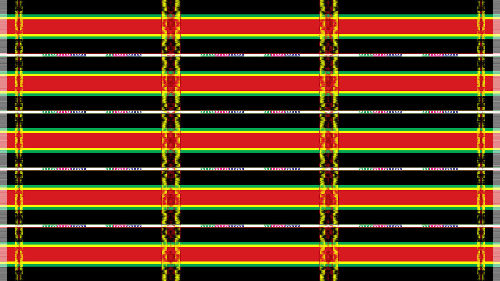

- **Also called:** Puandum, Paite Puan dum, black Paite puan
- **Aspect ratio:** 16:9 (horizontal)
- **Signature:** 5 red bands edged yellow then green on black, crossed by 4 yellow-and-red hatched vertical stripes that split the cloth into 3 columns.

**Palette**

| Colour | Hex |
|---|---|
| Pitch black (ground) | `#000000` |
| Crimson red (band core) | `#E31E24` |
| Lemon yellow | `#FFF200` |
| Bright green | `#00A83F` |
| White | `#FFFFFF` |
| Magenta-pink (motif) | `#FF1493` |
| Royal blue (motif) | `#1E32FA` |

**Canvas**

- Pitch-black (#000000) ground; short white warp fringes exclusively on the left and right vertical edges.
- Grid of 5 horizontal composite bands crossed by 4 vertical woven stripes.

**Horizontal bands (top to bottom)**

- 5 main composite bands, evenly spaced. Each is symmetrical: thin green (#00A83F) / lemon yellow (#FFF200) / wide crimson core (#E31E24, about 3x the combined yellow+green width) / lemon yellow / thin green.
- 4 black intervals between them, each about 1.5x the height of one composite band.
- Dead-centre of each black interval: a thin white line. Inside each of the 3 grid columns it breaks into 2 tri-colour lozenge segments ordered green (left), magenta-pink (centre), royal blue (right).

**Vertical stripes (left to right)**

- 2 outer borders just inside the fringes: two thin golden-yellow tracks flanking a narrow red/black woven core.
- 2 inner dividers that split the body into 3 equal columns, each twice as wide as an outer border: thick golden-yellow hatched tracks flanking a dark-red and black checkered core.
- All 4 vertical stripes are semi-translucent, cross-hatched basketweave that overlays the horizontal bands.

**Color ratio & proportions**

- Horizontal composite band vs black interval height ratio is approximately 1 : 1.5.
- Crimson core to yellow/green border ratio is approximately 3 : 1 (crimson core is ~3x the combined width of inner yellow and outer green borders).
- The 4 vertical stripes divide the cloth width into 3 equal central columns (ratio 1 : 1 : 1).
- Outer vertical borders vs inner vertical dividers: inner dividers are exactly twice as wide as outer borders (ratio 2 : 1).

**Order & sequence**

- Band layer sequence (symmetrical from outside in): thin green (#00A83F) -> lemon yellow (#FFF200) -> wide crimson core (#E31E24) -> lemon yellow -> thin green.
- Tri-color lozenge sequence along white accent lines: strictly ordered green (left) -> magenta-pink (center) -> royal blue (right).
- Vertical stripe sequence (left to right): outer border (left) -> inner divider (left-center) -> inner divider (right-center) -> outer border (right).

**Generation prompt**

> Flat top-down 2D textile pattern of a traditional Paite Puandum woven cloth, 16:9. Deep black background with 5 wide horizontal crimson-red bands, each bordered symmetrically on top and bottom by an inner bright-yellow and an outer bright-green thin stripe. Centred in each of the 4 black spaces between the red bands runs a thin white horizontal line carrying small woven geometric diamond motifs in green, magenta and blue segments. Crossing from top to bottom are 4 woven yellow-and-red cross-hatched vertical stripe columns: two thin ones near the left and right edges and two wider ones dividing the cloth into three equal sections. Crisp handloom cotton thread texture, short white fringes on the left and right edges only, exact geometric symmetry. Strict adherence to traditional pattern, color ratios (red core 3x yellow/green borders, black intervals 1.5x band height), and sequence order.

**Must-check:** Strict zero-variation compliance; 5 red bands; Ratio: red core 3x yellow/green borders; Ratio: black intervals 1.5x band height; 4 vertical stripes / 3 equal columns; Color order: green outside, yellow inside; Lozenge sequence: green-pink-blue

---

## 2. Siamsin Puan

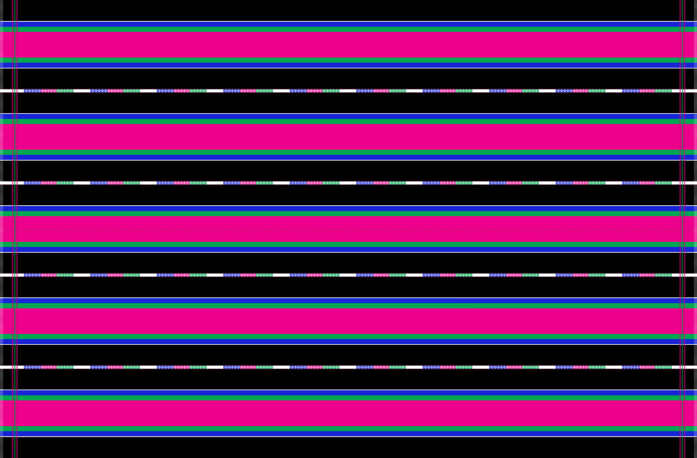

- **Also called:** Siamsin
- **Aspect ratio:** 3:2 (horizontal)
- **Signature:** Like Puandum but with hot-pink bands edged green then blue then white, and no interior vertical columns.

**Palette**

| Colour | Hex |
|---|---|
| Pitch black (ground) | `#000000` |
| Hot pink / magenta (band core) | `#FF0088` |
| Kelly green | `#00A83F` |
| Royal blue | `#1E32FA` |
| White | `#FFFFFF` |
| Red (edge pinstripes) | `#C81428` |

**Canvas**

- Pitch-black ground; short white warp fringes on the left and right edges only.
- 5 horizontal composite bands, 4 white motif lines, 2 edge pinstripes. No interior vertical dividers.

**Horizontal bands (top to bottom)**

- 5 main composite bands, evenly spaced. Each is symmetrical: white hairline / narrow royal blue (#1E32FA) / kelly green (#00A83F) / wide hot-pink core (#FF0088, about 3x the green+blue width) / kelly green / royal blue / white hairline.
- 4 wide black intervals between them (~1.5x band height).
- Dead-centre of each black interval: a thin white line carrying 10 evenly spaced tri-colour lozenge segments ordered royal blue (left), magenta-pink (centre), green (right).

**Vertical accents**

- Only 2: a very thin red/magenta twin-track pinstripe near each of the left and right edges, top to bottom. The central field stays uninterrupted.

**Color ratio & proportions**

- Hot-pink core to green/blue border ratio is approximately 3 : 1 (hot-pink core is ~3x the combined width of inner green and outer blue borders).
- 5 composite bands evenly spaced across pitch-black ground, separated by 4 wide black intervals (~1.5x band height).
- Exactly 10 evenly spaced tri-color lozenge segments per central white motif line.

**Order & sequence**

- Band layer sequence (symmetrical from outside in): white hairline (#FFFFFF) -> royal blue (#1E32FA) -> kelly green (#00A83F) -> wide hot-pink core (#FF0088) -> kelly green -> royal blue -> white hairline.
- Tri-color lozenge sequence along white accent lines: strictly ordered royal blue (left) -> magenta-pink (center) -> kelly green (right).
- Vertical accent sequence: only 2 thin red twin pinstripes near left and right edges; NO interior vertical dividing stripes.

**Generation prompt**

> Flat top-down 2D textile pattern of a traditional Paite Siamsin Puan woven cloth, 3:2. Deep black background with 5 wide horizontal hot-pink/magenta bands, each bordered symmetrically on top and bottom by inner bright-green, outer royal-blue and hairline white stripes. Centred in each of the 4 black spaces between the pink bands runs a thin white horizontal line with 10 evenly spaced woven geometric diamond motif segments in blue, pink and green. Only two very thin vertical red twin-pinstripe borders run near the left and right edges; the central field has no vertical stripes. Short white fringes on the left and right edges only, crisp handloom thread texture, exact geometric symmetry. Strict adherence to traditional pattern, color ratios (pink core 3x green/blue borders), and sequence order.

**Must-check:** Strict zero-variation compliance; 5 pink bands; Ratio: pink core 3x green/blue borders; 10 segments per white line; Lozenge sequence: blue-pink-green; No interior vertical stripes

---

## 3. Thangsuah Puan

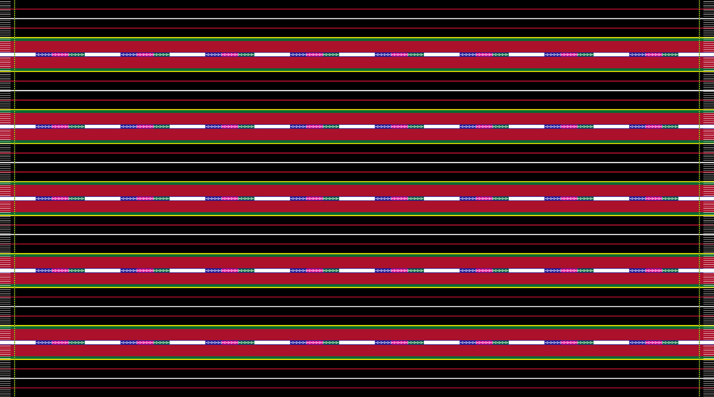

- **Also called:** Thangsuah
- **Aspect ratio:** 16:9 (horizontal)
- **Signature:** 5 crimson bands each split by a white motif line; every black gap holds red-white-red hairlines.

**Palette**

| Colour | Hex |
|---|---|
| Pitch black (ground) | `#000000` |
| Crimson red | `#C81428` |
| Lemon yellow | `#FFF200` |
| Kelly green | `#00A83F` |
| White | `#FFFFFF` |
| Magenta-pink (motif) | `#FF1493` |
| Royal blue (motif) | `#1E32FA` |

**Canvas**

- Pitch-black ground with short white side fringes exclusively on left and right edges.
- 5 crimson composite bands and 6 black intervals (top edge, bottom edge and 4 inner gaps).

**Crimson bands (x5, evenly spaced)**

- Symmetrical: lemon-yellow hairline (#FFF200) / kelly-green hairline (#00A83F) / upper crimson (#C81428) / narrow white motif line / lower crimson / kelly-green hairline / lemon-yellow hairline.
- The white line bisecting each band carries 8 evenly spaced tri-colour lozenge segments ordered royal blue (left), magenta-pink (centre), green (right).

**Black intervals (x6)**

- Each holds 3 evenly spaced ultra-thin horizontal pinstripes: red (#C81428), white, red.

**Vertical borders**

- A single thin yellow-and-green dashed vertical line near each of the left and right edges, just inside the fringes. No interior vertical columns.

**Color ratio & proportions**

- 5 crimson composite bands evenly spaced across 6 black intervals (including top and bottom edges).
- Crimson band core is bisected dead-center by a thin white motif line carrying exactly 8 tri-color lozenge segments.
- Each black interval contains 3 evenly spaced ultra-thin horizontal hairlines in 1:1:1 spacing.

**Order & sequence**

- Band layer sequence (symmetrical from outside in): lemon-yellow hairline (#FFF200) -> kelly-green hairline (#00A83F) -> upper crimson (#C81428) -> central white motif line (#FFFFFF) -> lower crimson (#C81428) -> kelly-green hairline -> lemon-yellow hairline.
- Black interval hairline sequence (top to bottom): red hairline (#C81428) -> white hairline (#FFFFFF) -> red hairline (#C81428).
- Tri-color lozenge sequence: strictly ordered royal blue (left) -> magenta-pink (center) -> kelly green (right).

**Generation prompt**

> Flat top-down 2D textile pattern of a traditional Paite Thangsuah Puan woven cloth, 16:9. Deep black background with 5 wide horizontal crimson bands, each split down its centre by a thin white horizontal line carrying 8 evenly spaced woven diamond motif segments in blue, pink and green. Each crimson band is bordered on top and bottom by a thin green and a thin yellow hairline. In the 6 black intervals (including top and bottom edges) run three fine horizontal pinstripes: red, white and red. Only a thin yellow-and-green dashed vertical border near the left and right edges; no interior vertical columns. Crisp handloom thread texture, short white fringes on the left and right edges only, exact geometric symmetry. Strict adherence to traditional pattern, color ratios, and sequence order.

**Must-check:** Strict zero-variation compliance; 5 crimson bands; White motif line INSIDE each red band with 8 segments; Lozenge sequence: blue-pink-green; Red-white-red hairlines in every black gap; Side borders: yellow-and-green dashed only

---

## 4. Puanlaisan

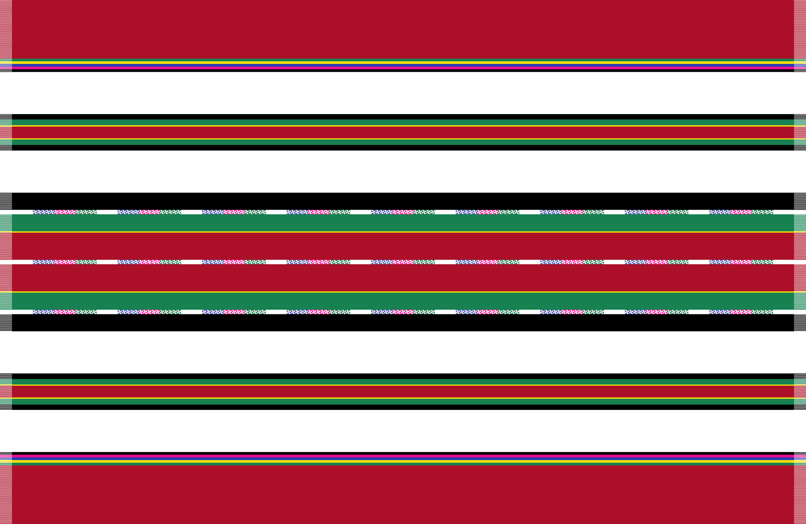

- **Also called:** Puan laisan, Laisan puan
- **Aspect ratio:** 3:2 (horizontal)
- **Signature:** Wide crimson top/bottom borders, white gaps, two narrow striped bands and one wide red-green-black central band with 3 motif lines.

**Palette**

| Colour | Hex |
|---|---|
| Deep crimson red | `#B81428` |
| Crisp white | `#FFFFFF` |
| Pitch black | `#000000` |
| Forest green | `#14823B` |
| Lemon yellow | `#FFF200` |
| Magenta-pink (motif) | `#FF0090` |
| Royal blue (motif) | `#1E32FA` |

**Canvas**

- Horizontal bands only, mirror-symmetric about the horizontal centre line. No vertical stripes.
- Short side fringes that take the colour of the stripe they continue (on left and right edges only).
- 9 zones from top to bottom: border / white / narrow band / white / central band / white / narrow band / white / border.

**Zones 1 and 9: crimson borders**

- Wide solid crimson bands, each about 12% of the height.
- Trimmed on their inner edge with 5 thin stripes: green, yellow, royal blue, magenta-pink, black hairline.

**Zones 2, 4, 6, 8: white intervals**

- Wide plain white horizontal bands, each about 8.5% of the height.

**Zones 3 and 7: narrow composite bands**

- Each about 7% of the height, symmetrical: black / green / yellow / red core / yellow / green / black.

**Zone 5: central Laisan band (about 26% of the height)**

- Symmetrical across 11 layers: black / white motif line / forest green / yellow hairline / crimson / white motif line (centre) / crimson / yellow hairline / forest green / white motif line / black.
- All 3 white lines carry 9 evenly spaced tri-colour lozenge segments ordered royal blue (left), magenta-pink (centre), green (right), vertically aligned across the three lines.

**Color ratio & proportions**

- Strict horizontal mirror symmetry across 9 distinct zones.
- Zones 1 & 9 (crimson borders): occupy ~12% of total canvas height each.
- Zones 2, 4, 6, 8 (solid white intervals): occupy ~8.5% of total canvas height each.
- Zones 3 & 7 (secondary composite bands): occupy ~7% of total canvas height each.
- Zone 5 (central Laisan core): occupies ~26% of total canvas height.
- Central band contains 3 white motif lines each with exactly 9 tri-color lozenge segments.

**Order & sequence**

- Zone sequence (top to bottom): Zone 1 (crimson border) -> Zone 2 (white) -> Zone 3 (secondary band) -> Zone 4 (white) -> Zone 5 (central Laisan core) -> Zone 6 (white) -> Zone 7 (secondary band) -> Zone 8 (white) -> Zone 9 (crimson border).
- Zone 1/9 inner trim sequence (from crimson toward white): green (#14823B) -> yellow (#FFF200) -> royal blue (#1E32FA) -> magenta-pink (#FF0090) -> black hairline (#000000).
- Zone 3/7 secondary band sequence (from outside in): black -> green -> yellow -> red core -> yellow -> green -> black.
- Zone 5 central band sequence (top to bottom): black outer -> upper white motif line (9 segments) -> green -> yellow -> crimson upper core -> central white motif line (9 segments, horizontal axis) -> crimson lower core -> yellow -> green -> lower white motif line (9 segments) -> black outer.
- Tri-color lozenge sequence: strictly ordered royal blue (left) -> magenta-pink (center) -> green (right).

**Generation prompt**

> Flat top-down 2D textile pattern of a traditional Paite Puanlaisan woven cloth, 3:2, with strict horizontal mirror symmetry and no vertical stripes. Wide solid crimson borders at top and bottom edges, each trimmed inward with fine green, yellow, blue, pink and black pinstripes. Separated by 4 wide solid-white spaces are two narrow composite bands (black-green-yellow-red-yellow-green-black) and one wide central composite band. The central band has outer black stripes, inner green bands, a wide double-crimson core, and 3 thin white horizontal lines (centre, and between the black and green layers), each carrying 9 evenly spaced diamond motifs in blue, pink and green. Short fringes on the left and right edges only, crisp handloom cotton texture. Strict adherence to traditional pattern, color ratios, and sequence order.

**Must-check:** Strict zero-variation compliance; Mirror symmetry across horizontal axis; 9 zones: crimson borders (~12%), white gaps (~8.5%), secondary bands (~7%), central core (~26%); 4 white gaps; 3 motif lines x 9 segments in central band; Lozenge sequence: blue-pink-green; 5-pinstripe trim on crimson borders

---

## 5. Galhang Puan

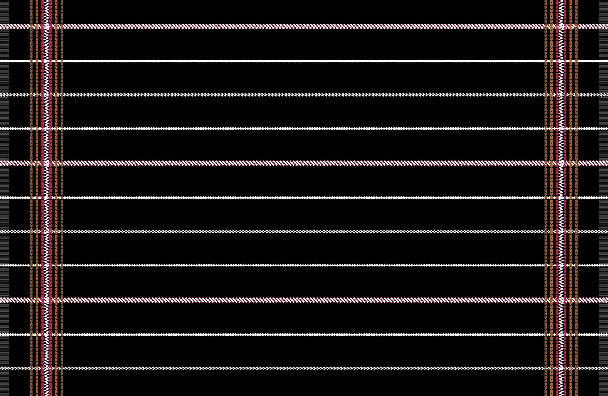

- **Also called:** Galhang
- **Aspect ratio:** 3:2 (horizontal)
- **Signature:** Black field with 11 thin horizontal lines (rope / solid / chain rhythm) and 2 multi-track vertical columns near the edges.

**Palette**

| Colour | Hex |
|---|---|
| Pitch black (ground) | `#000000` |
| Crimson red | `#C81E32` |
| White | `#FFFFFF` |
| Amber / raw umber | `#8B4513` |
| Golden orange | `#D2691E` |
| Bright crimson (verticals) | `#DC143C` |

**Canvas**

- Pitch-black ground with short grey/white side fringes on left and right edges only.
- 11 narrow horizontal lines across the full width, 2 vertical border columns near the edges.

**Horizontal lines (top to bottom)**

- Lines 1, 5, 9 (rope bands): thin composite bands of diagonal alternating crimson (#C81E32) and white (#FFFFFF) rope-twist segments.
- Lines 2, 4, 6, 8, 10 (solid white): crisp, narrow continuous white lines.
- Lines 3, 7, 11 (beaded chain): narrow white dotted/chain lines of tiny lozenge dots.
- Rhythm: rope / solid / chain / solid / rope / solid / chain / solid / rope / solid / chain.

**Vertical border columns (left and right only)**

- Each column is symmetrical from outer edge to centre across 6 tracks: amber dashed (#8B4513) / golden-orange dashed (#D2691E) / crimson track (#DC143C) / white vertical zigzag (#FFFFFF) / crimson track / golden-orange / amber.
- Run top to bottom near the fringes; no vertical lines in the central field.

**Color ratio & proportions**

- 11 horizontal lines evenly spaced across pitch-black ground.
- Strict 1-3-1-3-1-3-1 rhythm: Lines 1, 5, 9 are thicker crimson/white rope bands (~1.8x width of single white lines); Lines 2, 4, 6, 8, 10 are solid white hairlines; Lines 3, 7, 11 are dotted white chain lines.
- Vertical border columns occupy ~3.5% canvas width each, positioned inward ~4% from the side fringes.

**Order & sequence**

- Horizontal line sequence (top to bottom): Line 1 (rope band) -> Line 2 (solid white) -> Line 3 (beaded chain) -> Line 4 (solid white) -> Line 5 (rope band) -> Line 6 (solid white) -> Line 7 (beaded chain) -> Line 8 (solid white) -> Line 9 (rope band) -> Line 10 (solid white) -> Line 11 (beaded chain).
- Rope band segment order: diagonal alternating crimson-red (#C81E32) and white (#FFFFFF) rope-twist blocks.
- Vertical border column track sequence (symmetrical from outer edge to center): brown/amber (#8B4513) -> golden orange (#D2691E) -> red (#DC143C) -> white zigzag (#FFFFFF) -> red (#DC143C) -> golden orange (#D2691E) -> brown/amber (#8B4513).

**Generation prompt**

> Flat top-down 2D textile pattern of a traditional Paite Galhang Puan woven cloth, 3:2, on a pitch-black background. 11 thin horizontal lines follow a strict top-to-bottom rhythm: 3 red-and-white diagonal rope-twist bands (at positions 1, 5 and 9) separated by groups of three thin white lines (solid, dotted chain-link, solid). Near the left and right edges run two vertical composite border columns, each featuring a central white vertical zigzag line flanked by crimson red tracks and outer amber-gold dashed lines. Crisp handloom thread texture, short fringes on the left and right edges only, exact geometric symmetry. Strict adherence to traditional pattern, color ratios, and sequence order.

**Must-check:** Strict zero-variation compliance; 11 lines; Rope bands at 1, 5, 9; Solid white at 2, 4, 6, 8, 10; Beaded chains at 3, 7, 11; 2 edge columns with white zigzag enclosed in red tracks

---

## 6. Khephiau Puan

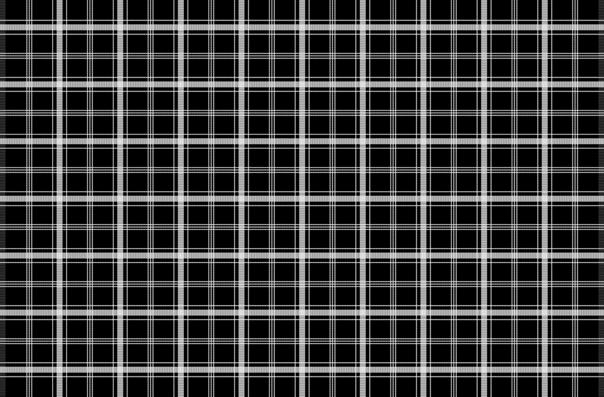

- **Also called:** Khephiau, Khep-hiau
- **Aspect ratio:** 3:2 (horizontal)
- **Signature:** Black-and-white windowpane plaid: 9 vertical x 7 horizontal light-grey basketweave bands, each flanked by thin white lines, with triple pinstripes midway.

**Palette**

| Colour | Hex |
|---|---|
| Pitch black | `#000000` |
| Crisp white | `#FFFFFF` |
| Light grey (basketweave core) | `#CDCDCD` |

**Canvas**

- Strictly monochrome pitch black, crisp white, and light-grey thread.
- Short grey-white fringes on the left and right edges only.
- Identical stripe assembly along both axes: 9 vertical columns intersecting 7 horizontal rows.

**Stripe assembly (identical horizontally and vertically)**

- Main composite band: thin white line / narrow black gap / medium light-grey basketweave core (#CDCDCD) / narrow black gap / thin white line.
- Between each pair of main bands, dead-centre in the black window: 3 ultra-thin white pinstripes spaced evenly.

**Counts and spacing**

- 7 horizontal assemblies (6 intervals) x 9 vertical assemblies (8 intervals).
- Forms a regular orthogonal windowpane plaid grid with square proportions in the central body.

**Color ratio & proportions**

- Orthogonal square plaid grid: 9 primary vertical stripe assemblies intersecting 7 primary horizontal stripe assemblies.
- Primary basketweave bands occupy ~5.5% canvas dimension each.
- Flanking white lines are thin hairlines (~0.8% dimension).
- Midway triple pinstripes: 3 ultra-thin white lines spaced evenly across the black windowpane gap.

**Order & sequence**

- Assembly sequence along both horizontal and vertical axes (symmetrical from outside in): thin white line -> narrow black gap -> wide black-and-white basketweave/checkered core -> narrow black gap -> thin white line.
- Midway gap sequence: centered between primary assemblies are 3 ultra-thin white pinstripes (white / black space / white / black space / white).
- Color palette is strictly monochrome pitch black (#000000), crisp white (#FFFFFF), and light-grey basketweave (#CDCDCD).

**Generation prompt**

> Flat top-down 2D textile pattern of a traditional Paite Khephiau Puan woven cloth, 3:2. Strictly monochrome pitch-black and crisp white windowpane plaid. 9 vertical and 7 horizontal composite bands intersect orthogonally; each composite band has a light-grey and white basketweave core flanked by a narrow black gap and a thin solid white line. Centred in each black square between the composite bands is a group of three ultra-thin white pinstripes running both horizontally and vertically. Crisp handloom cotton texture, short white fringes on the left and right edges only, exact geometric symmetry. Strict adherence to traditional pattern, color ratios, and sequence order.

**Must-check:** Strict zero-variation compliance; Only black/white/light grey; 9 vertical x 7 horizontal bands; Basketweave core flanked by white lines; Triple pinstripe midway

---

## 7. Ngoutekhelh Puan

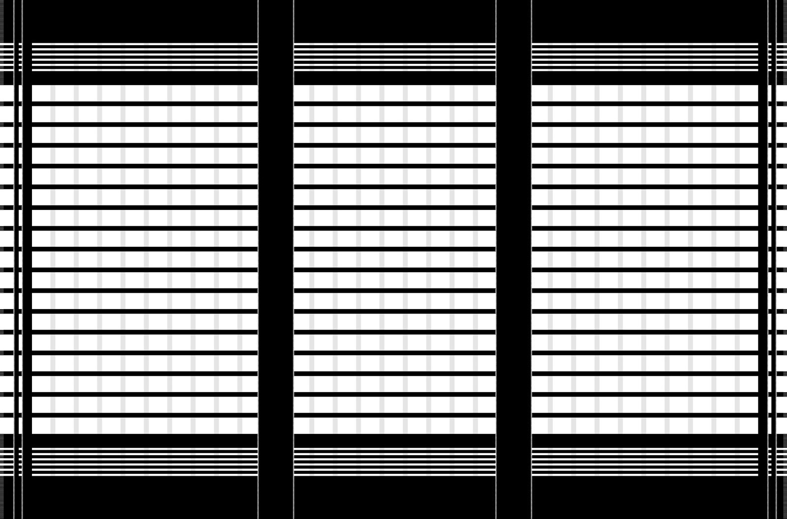

- **Also called:** Ngoutekhelh, Ngou-tekhelh
- **Aspect ratio:** 3:2 (horizontal)
- **Signature:** Black-and-white: 3 white-striped panels split by 2 wide black columns, with 5-stripe clusters at top and bottom.

**Palette**

| Colour | Hex |
|---|---|
| Pitch black | `#000000` |
| Crisp white | `#FFFFFF` |
| Off-white (warp ribs) | `#EBEBEB` |

**Canvas**

- Monochrome black and white cotton handloom with faint off-white (#EBEBEB) warp ribs.
- Short side fringes on left and right edges only.
- 3 vertical panels separated by 2 wide black columns; framed by top, bottom and side borders.

**Horizontal structure**

- Top and bottom outer borders: wide solid black bands (~8% height), each bordered inward by a cluster of 5 thin horizontal white stripes (separated by 4 black hairlines) and an inner black buffer stripe.
- Central body: 16 wide white horizontal bands separated by 15 thin black stripes. Inside each white band, ~9 faint vertical warp ribs create a subtle brick grid.

**Vertical structure**

- 2 central vertical dividers: wide solid black columns (about 4.5% of width each) with a crisp white dotted hairline on each edge, masking the horizontal white bands beneath.
- Outer side borders: narrow black stripe and two thin vertical pinstripes inside the side fringes.

**Color ratio & proportions**

- Cloth divided vertically into 3 equal central panels by 2 wide solid black columns (~4.5% canvas width each).
- Top and bottom outer borders: wide solid black bands (~8% canvas height each) followed inward by a cluster of 5 thin white stripes.
- Central striped body: 16 wide horizontal white bands separated by 15 thin black stripes (white bands ~3x width of black divider stripes).
- Subtle vertical ribbing: ~9 faint off-white (#EBEBEB) warp ribs per panel forming brick-like grid.

**Order & sequence**

- Vertical panel sequence (left to right): outer border -> Panel 1 (striped) -> black column 1 -> Panel 2 (striped) -> black column 2 -> Panel 3 (striped) -> outer border.
- Border cluster sequence (from edge inward): solid black border -> 5 white horizontal stripes separated by 4 black hairlines -> solid black buffer stripe -> central striped body.
- Divider column edge trim: each of the 2 wide black columns is flanked by a single crisp white dotted hairline pinstripe that masks all horizontal stripes beneath.

**Generation prompt**

> Flat top-down 2D textile pattern of a traditional Paite Ngoutekhelh Puan woven cloth, 3:2, in monochrome black and white. Divided vertically into 3 equal central panels by two wide solid-black vertical columns edged with white dotted hairlines. Top and bottom edges have wide solid black borders followed inward by clusters of 5 thin white horizontal stripes. The central body features 16 wide white horizontal bands separated by 15 thin black horizontal lines, with faint vertical off-white warp ribbing visible inside the white bands. Narrow black vertical pinstripes and short fringes on the left and right edges only. Strict adherence to traditional pattern, color ratios, and sequence order.

**Must-check:** Strict zero-variation compliance; 3 panels / 2 black columns; 16 white bands; 5-stripe clusters top and bottom; Monochrome black and white only

---

## 8. Mal-am Puan

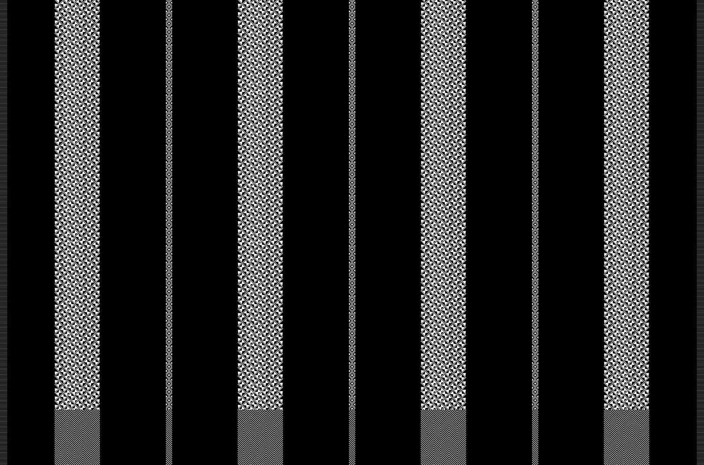

- **Also called:** Mal-am, Malam, Mal am
- **Aspect ratio:** 3:2 (horizontal)
- **Signature:** Black field with 4 wide vertical black-and-white triangle-lattice columns (herringbone at the base) and 3 thin diamond-chain strips.

**Palette**

| Colour | Hex |
|---|---|
| Pitch black | `#000000` |
| Crisp white | `#FFFFFF` |

**Canvas**

- Strictly monochrome pitch black and white.
- Short grey-white fringes on the left and right edges only.
- Purely vertical column structure from top to bottom; NO horizontal crossing stripes.

**Columns (left to right)**

- 4 wide patterned bands (each about 6.5% of width) alternating with 3 narrow accent strips (about 0.8% of width), separated by wide solid black intervals (~15% width). Solid black margins at the edges.
- Upper 88% of each wide band: dense black-and-white tessellated geometric weave of interlocking small triangles forming an hourglass / pinwheel diamond lattice.
- Lower 12% of each wide band: transitions cleanly into a fine, tight vertical herringbone / multi-column chevron twill weave down to the bottom edge.
- 3 narrow accent strips: centered in the black intervals; vertical chain of tiny white lozenges between white hairlines, switching to a fine diagonal hatch in the bottom 12%.

**Color ratio & proportions**

- Purely vertical column structure across black field: 4 wide patterned bands alternating with 3 thin accent strips.
- Wide patterned bands: occupy ~6.5% canvas width each, split vertically into upper 88% (triangle lattice) and lower 12% (herringbone twill).
- Narrow accent strips: occupy ~0.8% canvas width each, centered in the wide black spaces between main bands.
- Wide solid black intervals between bands occupy ~15% canvas width each.

**Order & sequence**

- Column sequence (left to right): black margin -> Band 1 (wide) -> black interval -> Strip 1 (thin) -> black interval -> Band 2 (wide) -> black interval -> Strip 2 (thin) -> black interval -> Band 3 (wide) -> black interval -> Strip 3 (thin) -> black interval -> Band 4 (wide) -> black margin.
- Vertical zone sequence inside wide bands (top to bottom): upper 88% dense tessellated black-and-white triangle/pinwheel lattice -> lower 12% transition into fine vertical herringbone/chevron weave.
- Narrow strip sequence: delicate chain of white lozenges in upper 88%, transitioning into diagonal hatch in lower 12%.

**Generation prompt**

> Flat top-down 2D textile pattern of a traditional Paite Mal-am Puan woven cloth, 3:2. Monochrome pitch-black background featuring 4 wide vertical white-and-black geometric patterned bands alternating with 3 very thin vertical white diamond-chain pinstripes, separated by wide solid black vertical spaces. The upper 88% of the 4 wide vertical bands is filled with a crisp interlocking black-and-white geometric triangle and diamond pinwheel lattice, which transitions cleanly in the bottom 12% into a fine dense black-and-white chevron herringbone weave. Short grey-white warp fringes on the left and right edges only, no horizontal stripes, exact geometric symmetry. Strict adherence to traditional pattern, color ratios, and sequence order.

**Must-check:** Strict zero-variation compliance; 4 wide + 3 thin vertical columns; Herringbone in bottom 12%; No horizontal stripes; Monochrome black and white only

---

## 9. Aksi Puan

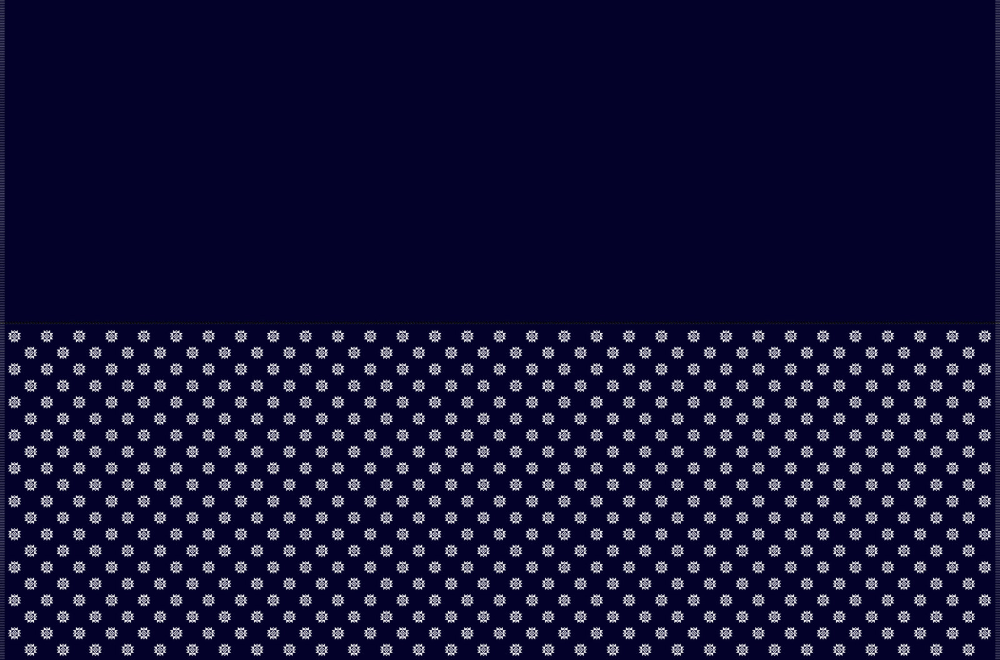

- **Also called:** Aksi, star puan
- **Aspect ratio:** 3:2 (horizontal)
- **Signature:** Midnight-indigo cloth, top half plain, bottom half covered in a staggered lattice of small white star (Aksi) motifs.

**Palette**

| Colour | Hex |
|---|---|
| Deep midnight indigo / navy-black | `#030322` |
| Crisp white | `#FFFFFF` |

**Canvas**

- Deep midnight indigo / navy-black (#030322) throughout; very fine grey/white side fringes on left and right edges only.
- Split horizontally into equal halves by a subtle single-thread seam.

**Top half**

- Completely plain solid midnight indigo occupying exactly 50% of canvas height.

**Bottom half: Aksi lattice**

- Edge-to-edge staggered (quincunx) grid of small white woven star motifs: 18 to 20 offset rows with about 30 motifs per row (rows alternate 31 / 30).
- Each Aksi is a tiny stepped/pixelated 8-point octagonal star or rosette in white thread with a dark indigo centre dot and an inner ring of 8 dark pixel dots.

**Color ratio & proportions**

- Bipartite horizontal split: canvas divided exactly 50% top and 50% bottom by a subtle center woven seam.
- Top half: exactly 50% height, completely plain and unadorned midnight indigo-black (#030322).
- Bottom half: exactly 50% height, filled with a dense staggered quincunx lattice of 18 horizontal rows (~30 star motifs per row, alternating 31 / 30).

**Order & sequence**

- Vertical zone sequence (top to bottom): upper 50% solid dark ground -> central woven hairline seam -> lower 50% Aksi star lattice.
- Aksi motif structure: stepped 8-point octagonal star/rosette in crisp white (#FFFFFF) thread, centered with a dark indigo dot and an inner ring of 8 dark indigo pixel dots.
- Color palette: strictly two colors — deep midnight indigo-black (#030322) and crisp white (#FFFFFF).

**Generation prompt**

> Flat top-down 2D textile pattern of a traditional Paite Aksi Puan woven cloth, 3:2. Deep midnight navy-black background split horizontally into two equal halves. The top half is completely solid, plain midnight navy-black. The bottom half is covered edge-to-edge in a uniform, staggered diagonal grid of 18 rows of small crisp white woven pixelated octagonal star/rosette motifs (Aksi), about 30 stars per row. Fine short horizontal warp fringes on the left and right edges only, crisp handloom thread texture, exact geometric symmetry. Strict adherence to traditional pattern, color ratios (exact 50/50 split), and sequence order.

**Must-check:** Strict zero-variation compliance; Top half plain (50%); Staggered white stars bottom half (50%); 18 offset rows of stars; Single dark ground colour

---

## 10. Pangpalek Puan

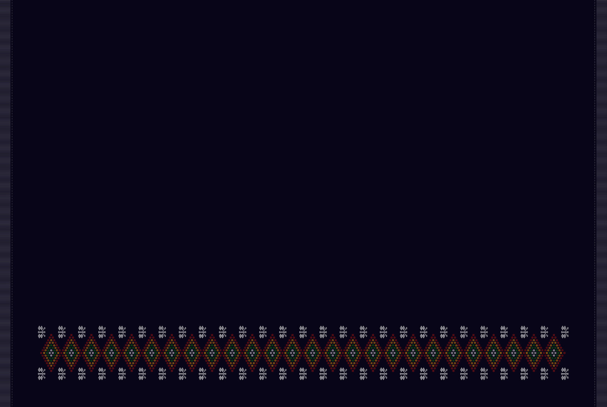

- **Also called:** Pangpalek, PAngpalek, butterfly puan, Senior
- **Aspect ratio:** 3:2 (horizontal)
- **Signature:** Plain midnight cloth with one border near the bottom: a chain of 26 red-orange-green stepped diamonds between rows of white butterflies.

**Palette**

| Colour | Hex |
|---|---|
| Deep midnight indigo-black | `#06051A` |
| Crimson red | `#B81D13` |
| Amber orange | `#E67E22` |
| Forest green | `#1E8449` |
| Crisp white | `#FFFFFF` |

**Canvas**

- Deep midnight indigo-black (#06051A); short grey-white side fringes on left and right edges only.
- Upper ~78% and bottom ~8% plain. One decorative border near the bottom, centred and spanning ~85% of the width, with plain dark margins at the sides.

**Pangpalek border (3 stacked rows)**

- Centre row: 26 touching stepped diamond lozenges. From outside in: crimson (#B81D13) and amber-orange (#E67E22) stepped outline / forest-green (#1E8449) stepped ring / dark centre with a white 5-dot cross.
- Rows above and below: 27 small white pixelated butterfly/hourglass motifs (Pangpalek) each, sitting over and under the valleys between diamonds, each split by a tiny red/green centre dot.

**Color ratio & proportions**

- Upper ~78% and bottom ~8% of canvas are completely plain solid midnight indigo-black (#06051A).
- Horizontal decorative border occupies ~14% canvas height near the bottom, centered and spanning ~85% canvas width with dark side margins.
- Border contains exactly 26 interlocking stepped diamond lozenges in the center row.
- Border contains exactly 27 white butterfly motifs (Pangpalek) in the row directly above, and 27 in the row directly below.

**Order & sequence**

- Vertical zone sequence (top to bottom): upper 78% plain midnight field -> Pangpalek decorative border (~14% height) -> bottom 8% plain midnight ground.
- Border row sequence (top to bottom): Row 1 (27 white butterfly motifs) -> Row 2 (26 interlocking concentric diamonds) -> Row 3 (27 white butterfly motifs).
- Diamond concentric layer sequence (outside in): outer crimson-red (#B81D13) and amber-orange (#E67E22) stepped border -> middle forest-green (#1E8449) stepped ring -> inner dark ground with white (#FFFFFF) 5-dot star/cross center.

**Generation prompt**

> Flat top-down 2D textile pattern of a traditional Paite Pangpalek Puan woven cloth, 3:2. Deep midnight navy-black background with the top 78% completely plain and unadorned. Near the bottom edge runs a single centred horizontal decorative border band composed of 26 interlocking concentric stepped diamonds in red, orange and green with tiny white cross centres, flanked directly above and below the diamond valleys by 27 small white geometric butterfly motifs (Pangpalek). Short grey-white warp fringes on the left and right edges only, exact geometric symmetry. Strict adherence to traditional pattern, color ratios, and sequence order.

**Must-check:** Strict zero-variation compliance; Only one border band near bottom; Top 78% and bottom 8% plain; 26 diamonds in centre row; 27 butterflies above and below

---

## 11. Lianbuangthuam Puan

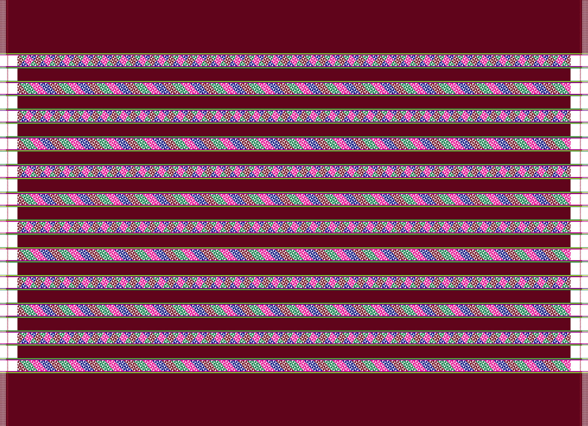

- **Also called:** Lianbuangthuam, Lianbuang thuam
- **Aspect ratio:** 4:3 (horizontal)
- **Signature:** Maroon cloth: wide plain top/bottom borders around 12 multicolour diagonal-weave bands, with white side strips.

**Palette**

| Colour | Hex |
|---|---|
| Deep maroon / burgundy | `#61071C` |
| Crisp white | `#FFFFFF` |
| Magenta-pink | `#FF1493` |
| Bright green | `#00A83F` |
| Royal blue | `#1E32FA` |
| Lemon yellow | `#FFF200` |

**Canvas**

- Deep maroon / burgundy (#61071C); short side fringes on left and right edges only.
- Wide plain maroon borders at the top and bottom, about 12% of the height each.

**Central bands**

- 12 decorative bands separated by 11 plain maroon intervals of equal thickness.
- Each band is framed above and below by ultra-thin yellow, green and white hairlines.
- Odd bands (1, 3, 5, 7, 9, 11): dense diamond-lattice weave in diagonal colour blocks of magenta-pink, green, maroon and royal blue, with tiny white crosses.
- Even bands (2, 4, 6, 8, 10, 12): stepped diagonal chevron / slanted stripes in the same palette, divided by white stepped-dot diagonals.

**Side margins**

- Beside the central zone only (not the top/bottom borders), the maroon intervals become solid white vertical strips (about 3% of the width) on the left and right.
- A thin red dotted vertical line runs down the middle of each white strip; the hairlines continue through it to the fringes.

**Color ratio & proportions**

- Top and bottom borders: solid plain maroon (#61071C) bands occupying ~12% canvas height each.
- Central patterned body: 12 horizontal multicolored decorative bands separated by 11 solid maroon intervals of equal thickness (~3.5% height each).
- Side margins: along the left and right of the central 12 bands (not the top/bottom borders), maroon intervals become solid white vertical strips (~3% canvas width each), bisected by a thin red dotted vertical pinstripe.

**Order & sequence**

- Vertical zone sequence (top to bottom): top maroon border (~12%) -> 12 alternating decorative bands and 11 maroon intervals -> bottom maroon border (~12%).
- Decorative band alternating weave sequence: Odd bands (1, 3, 5, 7, 9, 11) have dense diamond-lattice weave in diagonal blocks of magenta-pink, green, maroon, and royal blue with white crosses; Even bands (2, 4, 6, 8, 10, 12) have stepped diagonal chevron stripes in the same palette.
- Hairline border sequence: each of the 12 decorative bands is framed top and bottom by ultra-thin multicolored hairlines (yellow, green, white) that extend through the white side margins to the fringes.

**Generation prompt**

> Flat top-down 2D textile pattern of a traditional Paite Lianbuangthuam Puan woven cloth, 4:3, on a deep maroon (#61071C) background. Wide solid maroon borders at the top and bottom edges (~12% height each). The central body contains 12 evenly spaced horizontal multicoloured geometric bands separated by 11 solid maroon stripes. The 12 patterned bands alternate between diagonal diamond lattices and stepped chevron stripes in hot pink, bright green, royal blue, dark red and white, bordered by hairline green and yellow threads. Along the left and right edges of the central section only are narrow white vertical border strips bisected by a thin red pinstripe, leading to short side fringes on the left and right edges only. Strict adherence to traditional pattern, color ratios, and sequence order.

**Must-check:** Strict zero-variation compliance; 12 bands / 11 maroon gaps; Plain wide top & bottom borders (~12% each); Odd bands diamond-lattice, even bands diagonal chevrons; White side strips only beside the bands

---

## 12. Puanthupi Puan

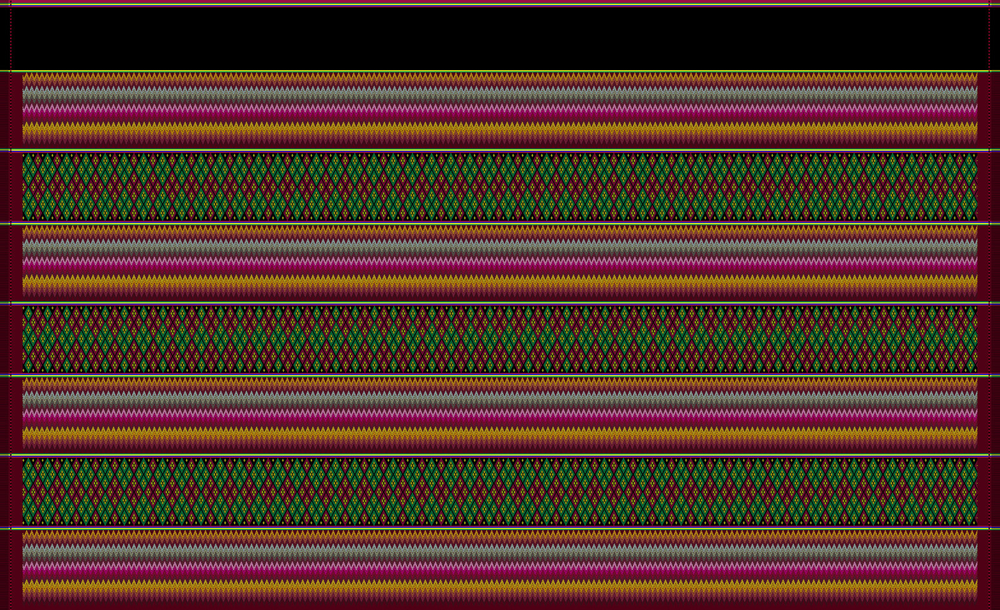

- **Also called:** Puanthupi, Puan thupi, great cloth
- **Aspect ratio:** 16:10 (horizontal)
- **Signature:** Black header over 7 stacked bands alternating flame-stitch zigzag (x4) and green/red diamond lattice (x3) on dark maroon.

**Palette**

| Colour | Hex |
|---|---|
| Deep burgundy / dark maroon | `#4A0414` |
| Pitch black | `#000000` |
| Golden yellow | `#FFD700` |
| Amber orange | `#E67E22` |
| Crisp white | `#FFFFFF` |
| Magenta-pink | `#FF1493` |
| Forest green | `#00A83F` |
| Lime green (hairlines) | `#76FF03` |
| Royal blue / cyan (hairlines) | `#00B0FF` |

**Canvas**

- Dark maroon (#4A0414) ground that also forms narrow plain vertical margins at the left and right; dark maroon/black side fringes on left and right edges only.
- Dense, intricate micro-woven texture.

**Top header (~11% of the height)**

- Solid pitch-black band at the top edge, with a thin maroon/white hairline along the very top and a lime-green and white hairline below it.

**7 stacked bands (top to bottom)**

- Bands 1, 3, 5, 7 - flame stitch: 4 tiers of fine vertical sawtooth teeth (Bargello effect). (1) golden yellow + amber into maroon; (2) white + silver grey into olive brown; (3) white into magenta-pink and crimson; (4) golden yellow + ochre into maroon.
- Bands 2, 4, 6 - diamond lattice: dense diagonal argyle trellis of forest-green tracks with yellow/white nodes; crimson/maroon diamond cores with tiny yellow-white star dots; about 48-50 diamond columns across.

**Dividers (x6)**

- Narrow maroon strips with 3 ultra-thin hairlines (lime green #76FF03, white, cyan blue #00B0FF) that continue through the side margins to the fringes.

**Color ratio & proportions**

- Top header band: solid pitch-black (#000000) occupying ~11% canvas height.
- Patterned body: 7 wide horizontal decorative bands stacked tightly, alternating between 4 flame-chevron bands (~11.5% height each) and 3 diamond-lattice bands (~10% height each).
- Separated by 6 three-hairline divider strips (~1.5% height each).
- Narrow solid dark maroon margins (~2.5% width) along left and right edges.
- Diamond-lattice bands: ~48–50 repeating diamond columns across the cloth width.

**Order & sequence**

- Vertical band sequence (top to bottom): solid black header -> Divider 1 -> Band 1 (Flame) -> Divider 2 -> Band 2 (Lattice) -> Divider 3 -> Band 3 (Flame) -> Divider 4 -> Band 4 (Lattice) -> Divider 5 -> Band 5 (Flame) -> Divider 6 -> Band 6 (Lattice) -> Divider 7 -> Band 7 (Flame).
- Flame-chevron internal tier sequence (top to bottom within each flame band): Tier 1 (golden-yellow #FFD700 and amber-orange #E67E22) -> Tier 2 (crisp white #FFFFFF and silver-grey #A6ACAF) -> Tier 3 (crisp white into magenta-pink #FF1493 and crimson #900C3F) -> Tier 4 (golden-yellow and ochre into maroon base).
- Diamond-lattice core structure: intersecting diagonal forest-green (#00A83F) tracks with yellow/white stitch nodes, enclosing deep crimson/maroon cores with tiny yellow-white star dots.
- Divider hairline sequence (top to bottom): lime-green (#76FF03) -> crisp white (#FFFFFF) -> royal blue/cyan (#00B0FF).

**Generation prompt**

> Flat top-down 2D textile pattern of a traditional Paite Puanthupi Puan woven cloth, 16:10. A wide solid pitch-black header band at the very top (~11% height). Below it, 7 wide tightly stacked horizontal geometric woven bands alternating between 4 flame-stitch zigzag bands and 3 green-and-maroon diamond-lattice bands, separated by thin white, lime-green and blue hairline dividers. Each flame-stitch band has 4 tiers of fine vertical sawtooth zigzags: (1) yellow-orange, (2) white-grey, (3) white-magenta-pink, (4) golden yellow, on a dark maroon ground. Each diamond-lattice band is a dense diagonal green trellis filled with dark red diamonds and tiny yellow centre dots. Narrow dark maroon vertical margins and short fringes on the left and right edges only. Strict adherence to traditional pattern, color ratios, and sequence order.

**Must-check:** Strict zero-variation compliance; Black header at top (~11% height); 7 bands: flame/lattice alternating, flame first and last; Flame bands have 4 shaded tiers: yellow/orange, white/grey, white/pink/crimson, golden-yellow; Lattice bands have ~48-50 green diamonds with red cores and yellow center dots; 6 three-hairline dividers (lime green, white, blue)
